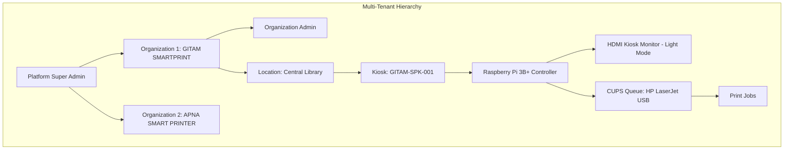
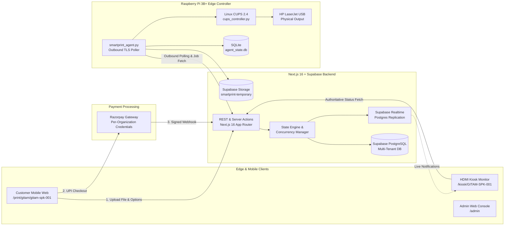

# GITAM SMARTPRINT — Complete System Architecture

## 1. System Topology & Multi-Tenant Hierarchy

GITAM SMARTPRINT is an autonomous, multi-tenant, zero-retention cloud & IoT printing platform designed for campus and organizational deployments.

---

## 2. Component Architecture

---

## 3. Technology Stack & Fixed Architectural Decisions

- **Frontend Application**: React 19 / Next.js 16 (App Router), Vanilla CSS & TailwindCSS with Light/White + Amber Accent palette.
- **Authentication**: Firebase Authentication with server-side token validation and database role authorization.
- **Database**: Supabase PostgreSQL with multi-tenant row-level security and atomic reservation functions.
- **File Storage**: Private Supabase Storage bucket (`smartprint-temporary`) via provider-independent `IStorageService` abstraction.
- **Live Updates**: Supabase Realtime for instant event push + fallback authoritative HTTP polling.
- **Payments**: Razorpay configured per organization with integer paise precision and raw webhook signature verification.
- **Controller Hardware**: Raspberry Pi 3B+ (ARMv7 / aarch64) running Raspberry Pi OS Lite.
- **Monitor Display**: Dedicated HDMI monitor in fullscreen Chromium/Cage kiosk mode running strict state machine.
- **Print Engine**: Linux CUPS (Common Unix Printing System) with native IPP/raster drivers.
