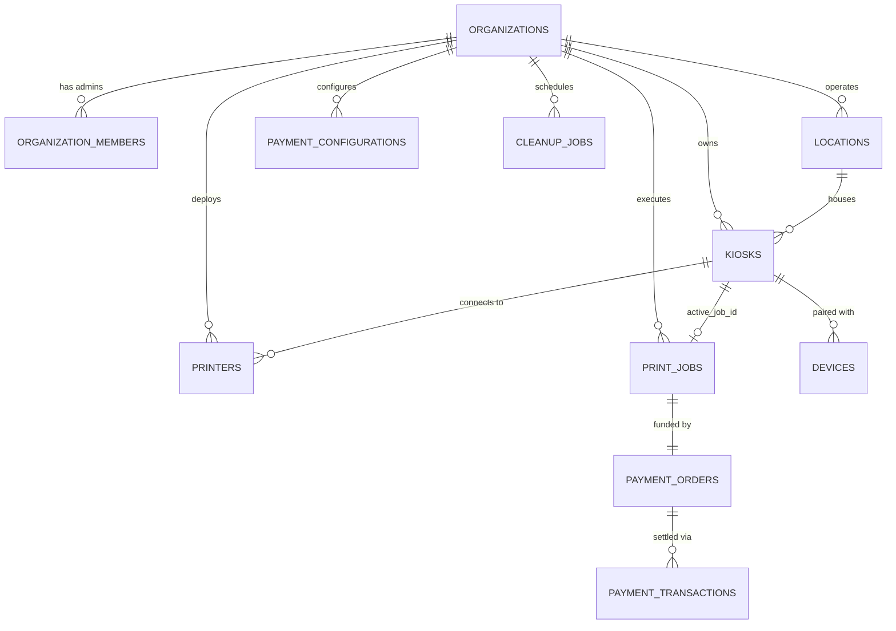

# Database Schema & Entity Design

## 1. Schema Overview

The database uses PostgreSQL on Supabase, structured to enforce organization tenancy, idempotency, and concurrency protection across all operations.

---

## 2. Core Entities

1. `organizations`: Root tenant entity (id, name, slug, brand_colors, public_url, status).
2. `organization_members`: Admins bound to organizations with roles (`SUPER_ADMIN`, `ORG_ADMIN`).
3. `locations`: Physical campuses/buildings.
4. `kiosks`: Physical kiosk units (`active_job_id`, `status`, `device_token_hash`, `maintenance_mode`).
5. `devices`: Raspberry Pi 3B+ devices reporting telemetry (`cpu_temp`, `ram_usage`, `disk_usage`).
6. `printers`: CUPS printer queues (`cups_queue_name`, `status`, `supports_color`, `supports_duplex`).
7. `payment_configurations`: Per-organization Razorpay credentials (`razorpay_key_id`, encrypted secrets).
8. `payment_orders`: Orders generated in integer paise (`amount_paise`, `currency`).
9. `webhook_events`: Idempotent deduplication store for gateway callbacks.
10. `print_jobs`: Durable state machine records (`pages_total`, `calculated_amount`, `amount_paise`, `status`).
11. `cleanup_jobs`: Ephemeral storage deletion tracking queue.
