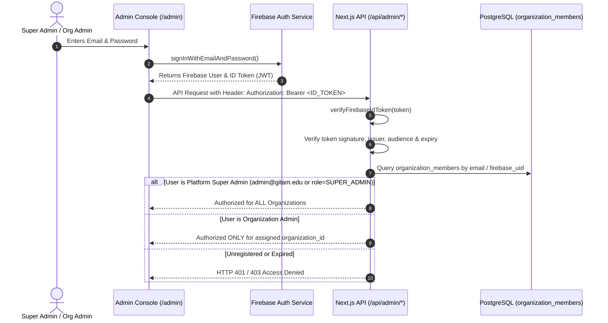

# Firebase Authentication & Administrative Authorization

## 1. Overview

Administrative access to GITAM SMARTPRINT is authenticated via **Firebase Authentication** and independently authorized by the trusted backend against database organization memberships.

---

## 2. Super Admin Permissions vs Organization Admin Permissions

| Operation | Platform Super Admin | Organization Admin |
| :--- | :---: | :---: |
| Create New Organization | ✓ | ✗ |
| View All Organizations | ✓ | ✗ |
| Manage Platform Global Policies | ✓ | ✗ |
| Register Raspberry Pi Hardware | ✓ | Scoped to Org |
| Configure Razorpay Credentials | ✓ | Scoped to Org |
| Manage Organization Pricing | ✓ | Scoped to Org |
| View Organization Print Jobs | ✓ | Scoped to Org |
| View Organization Audit Logs | ✓ | Scoped to Org |

---

## 3. Trusted Initial Provisioning

1. The platform initializes `admin@gitam.edu` as the foundational Super Admin in `003_multi_tenant_architecture.sql`.
2. New organization administrators are invited by the Super Admin via `/api/admin/organizations/[orgId]/members`, generating a database invitation with assigned organization binding.
3. Client-side variables such as `isSuperAdmin = true` are **never trusted**. Every privileged API route verifies the user's role on the server.
