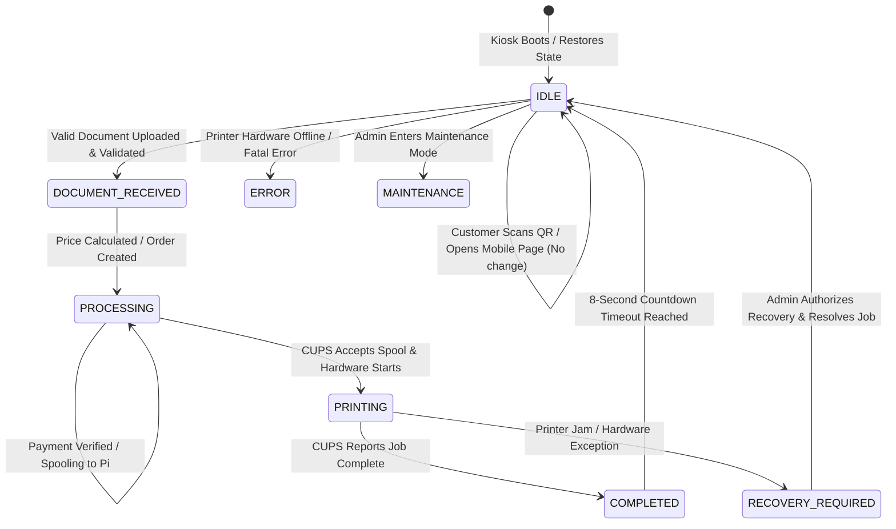

# Kiosk Monitor State Machine & Concurrency Specification

## 1. Core Principle: Static Monitor Until Valid Upload

The physical HDMI monitor connected to the Raspberry Pi 3B+ behaves as a dedicated, autonomous kiosk display—not an interactive customer website. It is rendered in a **premium light/white layout with dark text and restrained golden accents**, providing high legibility across 1080p and 720p displays.

---

## 2. Monitor State Reference

### State A: `IDLE` (Default Static State)
- **Visuals**: Static, calm, zero distracting animations or fake countdowns.
- **Displayed Elements**:
  - Organization Logo & Branding: *GITAM SMARTPRINT*
  - Permanent Kiosk QR Code: Points to public entry `/print/gitam/gitam-spk-001`
  - Instruction Tagline: *“Scan. Upload. Pay. Print.”*
  - Pricing Strip: B&W (₹1/page) and Colour (₹5/page)
  - Real-Time Hardware Status: Printer Online/Ready
  - Privacy Statement: *“Zero-Retention File Privacy”*
  - Support & Attribution: Support *9006496970* • Powered by *Nikhil*
- **Trigger to Leave**: Only a **successful, validated document upload** targeting this specific kiosk.

### State B: `DOCUMENT_RECEIVED`
- **Visuals**: Privacy-safe confirmation with clean amber border.
- **Displayed Elements**:
  - “Document received successfully.”
  - Masked Public Job Reference: `SP-****-6402` (Never reveals private filename, student name, or storage URL)
  - Subtitle: “Validating document structure & billable pages...”

### State C: `PROCESSING`
- **Sub-state 1 (Awaiting Payment)**:
  - Displays “Complete Payment On Mobile”.
  - Subtitle: “Please approve the Razorpay UPI transaction on your phone.”
  - Does NOT pretend physical printing has begun.
- **Sub-state 2 (Payment Verified & Spooling)**:
  - Displays “Payment Verified ✓ — Preparing Document For Printer”.
  - Document spooled securely to local Raspberry Pi CUPS print engine.

### State D: `PRINTING`
- **Visuals**: Active job card with emerald green accents.
- **Displayed Elements**:
  - “Printing In Progress”
  - Masked Job ID, Page Count, Copy Count, B&W/Colour mode.
  - Guidance: “Please collect your pages from the printer output tray.”

### State E: `COMPLETED`
- **Visuals**: Success badge with emerald confirmation.
- **Displayed Elements**:
  - “Print Completed Successfully ✓”
  - Privacy Notice: “Zero-Retention File Privacy: Temporary document permanently shredded.”
  - Countdown: “Returning to IDLE screen in 8s...”
- **Transition**: Automatically fires `POST /api/kiosk/[kioskId]/status` with `action: reset_idle` and returns monitor to State A (`IDLE`).

### State F: `ERROR` / `RECOVERY_REQUIRED`
- **Visuals**: Non-intrusive alert card without leaking sensitive stack traces.
- **Rule**: Kiosk does NOT silently reprint or return to IDLE until the problem is safely resolved or overridden by an administrator.

---

## 3. Concurrency Protection & Anti-Collision Policy

Each physical kiosk supports **one active customer print workflow** at a time:
1. When Customer 1 uploads a valid document, the backend atomically sets `kiosk.active_job_id = jobId`.
2. If Customer 2 attempts to upload a document to the same kiosk while Customer 1 is in progress:
   - The upload is atomically rejected with **HTTP 409 Conflict**.
   - Customer 2 receives a clear message: *“Kiosk is currently processing a print job for another customer. Please wait for the current job to finish.”*
   - Customer 1’s monitor display remains completely undisturbed.
3. Upon job completion and timeout expiry, the reservation is released (`kiosk.active_job_id = null`), permitting the next customer's upload.
