# Zero-Retention File Privacy & Ephemeral Document Lifecycle

## 1. Zero-Retention Privacy Promise

GITAM SMARTPRINT guarantees absolute document privacy:
- Customer files are **ephemeral payloads** processed exclusively for printing.
- No customer document is ever permanently retained, indexed, or archived.
- File bytes reside temporarily in the private bucket `smartprint-temporary` or volatile in-memory buffer.
- As soon as CUPS confirms successful print execution, the document is destroyed across all layers.

```mermaid
graph TD
    subgraph Lifecycle["Ephemeral Document Lifecycle"]
        Upload[1. Upload by Customer] --> Validate[2. In-Memory Validation & Page Extraction]
        Validate --> Spool[3. Ephemeral Spooling in smartprint-temporary]
        Spool --> Payment[4. Payment Verified]
        Payment --> PiFetch[5. Raspberry Pi Downloads Document over TLS]
        PiFetch --> LocalSpool[6. Spooled locally to /var/lib/smartprint/jobs/id.pdf]
        LocalSpool --> CUPS[7. Transmitted to CUPS Raster Pipeline]
        CUPS --> Print[8. Physical Output Produced]
        Print --> Shred[9. Local Pi executes shred -u id.pdf]
        Shred --> CloudPurge[10. Cloud Backend purges bucket object & nullifies pointers]
        CloudPurge --> Purged[(Document Completely Shredded)]
    end
```

---

## 2. Automated Cleanup Worker (`/api/cron/cleanup`)

To guarantee zero lingering data in cases of abandoned sessions or uncompleted transactions:
1. **Completed Jobs**: Any completed job whose storage object is still recorded is immediately purged.
2. **Abandoned Unpaid Uploads**: Uploads older than 30 minutes where payment was not completed are purged, and the job status is marked `EXPIRED`.
3. **Failed / Stale Jobs**: Failed jobs older than 24 hours are cleared.
4. **Scheduled Execution**: Invoked periodically by the systemd timer `smartprint-cleanup.timer` or a platform cron job.
