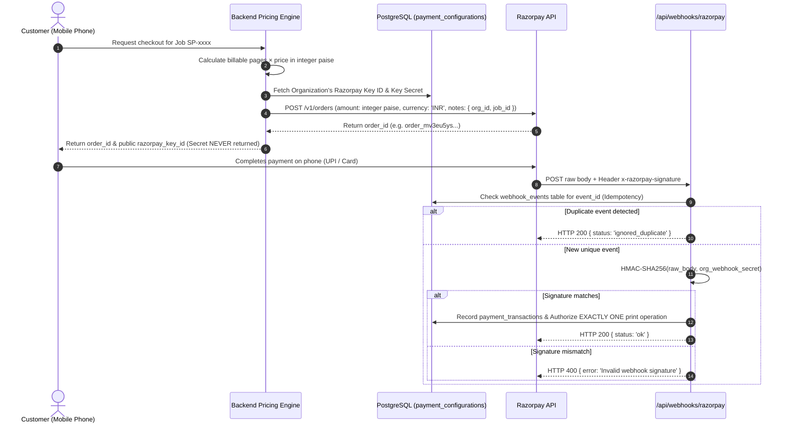

# Organization-Specific Razorpay Integration & Webhook Verification

## 1. Overview & Security Model

Each organization within GITAM SMARTPRINT configures its own Razorpay payment gateway credentials. Secrets are stored securely in `payment_configurations` and are **never exposed to frontend clients**.



---

## 2. Integer Paise Precision Guarantee

To prevent rounding errors and currency discrepancy attacks:
- All financial calculations are computed and recorded in **integer paise** ($1 \text{ INR} = 100 \text{ paise}$).
- Default B&W rate: `100 paise` ($₹1.00$).
- Default Colour rate: `500 paise` ($₹5.00$).
- Floating-point arithmetic is never used for currency storage or gateway submission.

---

## 3. Webhook Idempotency

Razorpay webhooks can be retried multiple times. Idempotency is enforced through the `webhook_events` table:
```sql
CREATE TABLE IF NOT EXISTS webhook_events (
    id VARCHAR(128) PRIMARY KEY, -- event_id from Razorpay payload
    organization_id UUID REFERENCES organizations(id),
    event_type VARCHAR(100) NOT NULL,
    payload JSONB NOT NULL,
    processed_at TIMESTAMP WITH TIME ZONE DEFAULT CURRENT_TIMESTAMP
);
```
Duplicate events with the same `event_id` are safely acknowledged without creating duplicate authorizations.
